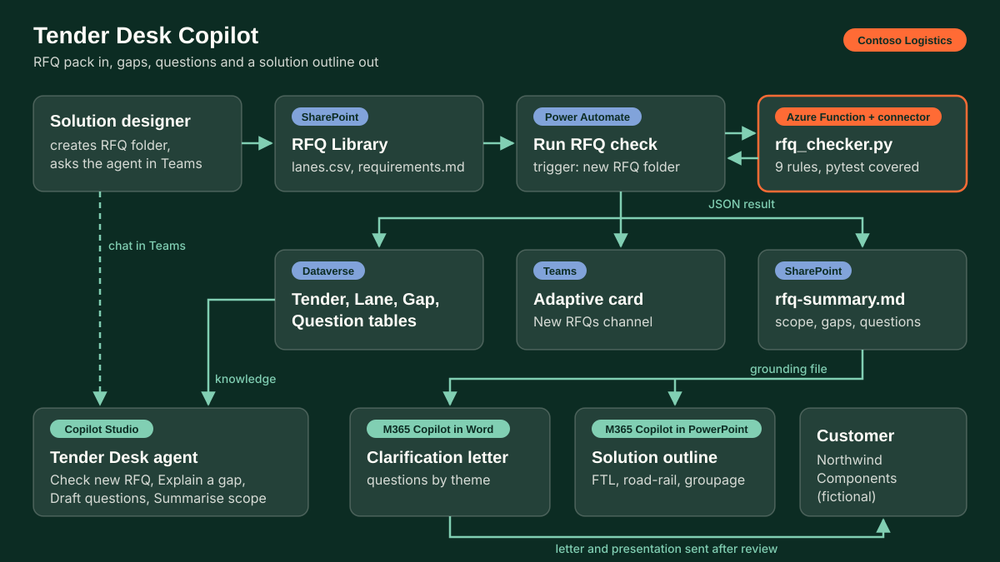

# Tender Desk Copilot

Solution designers receive RFQ packs as a lane spreadsheet plus a requirements document and spend days finding gaps before any pricing can start. Tender Desk checks the pack in seconds, lists every gap with a rule id and severity, drafts the clarification questions, and proposes a mode per lane band so the team can go back to the customer the same day.

Live demo: [`site/demos/01-tender-desk-copilot.html`](../../site/demos/01-tender-desk-copilot.html) (simulated, runs in the browser).

## Problem
- Lane files arrive with blank volumes, missing pallet sizes, invalid or sea-only Incoterms, hazardous goods without UN numbers, transit times no truck can meet, and duplicate lanes.
- Requirements documents miss sections (fuel, invoicing) or leave items "TBC".
- Each gap found late means a re-price. Each gap found early is one line in a clarification letter.

## Solution
| Output | How |
|---|---|
| Scope summary | countries, modes requested, known annual pallets and shipments, hazardous lanes, top corridors |
| Gap list | nine rules, R01 to R09, each with severity (high, medium, low) |
| Clarification questions | grouped by theme, lane ids listed per question |
| Solution-design outline | mode per lane band: FTL, multimodal road-rail, LTL/groupage, pending data; next steps |

### Rules
| Id | Rule | Severity | Logic |
|---|---|---|---|
| R01 | Missing annual volume | high | `annual_shipments` or `pallets_per_shipment` blank, zero or not a number |
| R02 | Missing pallet dimensions | medium | any of length, width, height blank |
| R03 | Unclear Incoterm | medium | blank, or first token not an Incoterms 2020 rule (catches `TBC`, `DDU`, `EXW/FCA`) |
| R04 | Sea-only Incoterm on a road lane | low | FAS, FOB, CFR, CIF |
| R05 | Hazardous goods without UN number | high | hazardous = Y and UN number not `UNnnnn` |
| R06 | Unrealistic transit time | high | requested days below `ceil(km / 650)` (single driver, EU driving-time rules) |
| R07 | Duplicate lane | medium | same origin and destination city as an earlier lane |
| R08 | Requirements section missing | medium | no heading for contract period, service levels, pricing, fuel, liability, invoicing |
| R09 | Open item marked TBC | low | any line with `TBC` or `TBD` |

Mode bands: 22+ pallets per shipment is FTL; FTL lanes over 1,100 km shipped at least weekly are flagged for a road-rail test; below 22 pallets is LTL/groupage; no volume is "Pending data".

## Architecture


## Microsoft stack
| Component | What it does |
|---|---|
| SharePoint, RFQ Library | One folder per RFQ (`lanes.csv`, `requirements.md`). Also the agent's knowledge and the home of `rfq-summary.md` |
| Power Automate, "Run RFQ check" | Triggers on a new RFQ folder, calls the checker, writes Dataverse rows, creates `rfq-summary.md`, posts an adaptive card to Teams (`power-automate/run-rfq-check.md`, `.json`) |
| Azure Function + custom connector | Hosts `src/rfq_checker.py` behind `POST /api/check-rfq` (`src/function_app.py`) |
| Dataverse | Tender, RFQ Lane, RFQ Gap, Clarification Question (`dataverse/schema.md`) |
| Copilot Studio, agent "Tender Desk" | Topics "Check new RFQ", "Explain a gap", "Draft clarification questions", "Summarise scope" (`copilot-studio/`) |
| Microsoft Teams | Channel card for each new RFQ; the agent is published to the Tender Desk team |
| Microsoft 365 Copilot in Word | Turns the question list into the clarification letter from the approved template |
| Microsoft 365 Copilot in PowerPoint | Builds the customer solution outline from `rfq-summary.md` |

## Data
Synthetic and seeded (`python src/generate_data.py`). Fictional shipper Northwind Components, fictional operator Contoso Logistics.
- `data/northwind-europe-2027/`: 40 lanes from four plants (DE, CZ, PL, HU) across 14 countries, with seeded gaps: 3 missing volumes, 4 missing dimensions, 4 unclear and 2 sea-only Incoterms, 3 hazardous lanes without UN numbers, 3 impossible transit times, 2 duplicates, plus 2 missing sections and 2 TBC items in the requirements. The checker finds all 25.
- `data/northwind-spares-2027/`: 18 part-load lanes, 3 gaps.

## Run it
```bash
python src/generate_data.py                                   # rebuild the packs
python src/rfq_checker.py data/northwind-europe-2027 --markdown
python -m pytest                                              # 50 tests, includes the JS parity check
python src/export_demo.py                                     # refresh demo JSON and inline data
node src/check_parity.js                                      # JS port == Python on every pack
```

## Deploy into a tenant
1. **SharePoint**: create site `Tender Desk` with library `RFQ Library`; break permissions per RFQ folder. Add library `Solution templates` with `Clarification letter.docx` (content controls for shipper, title, due date, a repeating section for questions) and an outline `.pptx`.
2. **Dataverse**: create solution `TenderDesk` and the four tables in `dataverse/schema.md`; add the two security roles.
3. **Azure Function**: create a Python 3.11 Function App, deploy `src/rfq_checker.py` and `src/function_app.py` with `requirements.txt` containing `azure-functions`; `func azure functionapp publish <app>`. Note the function key.
4. **Custom connector**: in Power Automate, New custom connector from blank, host `<app>.azurewebsites.net`, operation `CheckRfq` = `POST /api/check-rfq`, API key auth with header `x-functions-key`. Import the response schema by pasting one output from `site/demos/data/01-northwind-europe-2027.json` (`result` object).
5. **Flows**: build "Tender Desk - Run RFQ check" and "Tender Desk - Create clarification draft" in the solution, following `power-automate/run-rfq-check.md`; use `run-rfq-check.json` as the reference for expressions. Use connection references so the solution moves between environments.
6. **Copilot Studio**: create agent "Tender Desk" in the same environment; paste `copilot-studio/agent-instructions.md`; add knowledge per `copilot-studio/knowledge.md`; for each file in `copilot-studio/topics/` create a topic, open the code editor and paste the YAML; replace the placeholder `flowId` values by selecting the flows in the Action node.
7. **Teams**: create team `Tender Desk` with channel `New RFQs`; publish the agent to Teams and Microsoft 365 Copilot; restrict to the Solution Design group.
8. **Test**: upload `data/northwind-europe-2027/` as a new folder. Expect the Teams card to show 40 lanes, 55% ready to price, 9 high gaps, matching the demo.

## How it was built
- **GitHub Copilot ready:** the repo root holds `.github/copilot-instructions.md`, so Copilot Chat and agent mode pick up the project rules (synthetic data only, tests first, British English, hampy brand) for every follow-up change.
- Drafted with AI pair programming: the CSV parsing and report boilerplate, the parametrised pytest cases, the JavaScript port of the rules, the topic YAML scaffolding and the flow JSON sketch.
- Design decisions: the nine rules and their severities, the 650 km per day and 22-pallet thresholds, the question wording for customers, and which gaps are seeded in the synthetic data.
- Guard rail against drift between the two ports: `check_parity.js` runs the page's JavaScript rules on every pack and must equal the Python output exactly; it runs inside pytest.

Inspired by: tender and RFQ solution design for large multinational accounts, from data discovery through to customer presentation.
