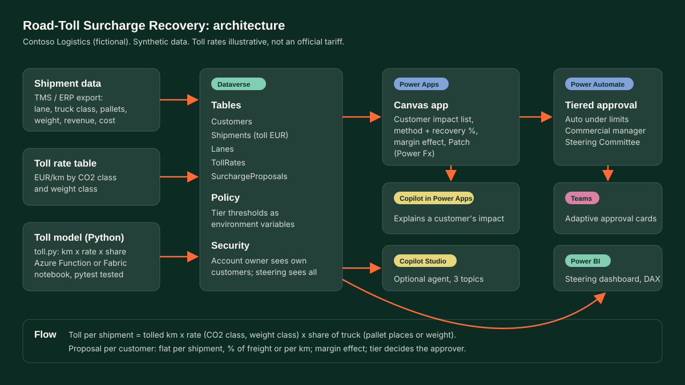

# 02 Road-Toll Surcharge Recovery App

> **Illustrative toll rates.** The rate table in this project is invented for the demo (by CO2 emission class and weight class). It is not an official tariff of any government or toll operator. All data is synthetic, for the fictional company Contoso Logistics.

## Problem
A new per-kilometre road toll for heavy goods vehicles applies to every truck on tolled roads from day one. A logistics operator with thousands of customer contracts must answer three questions fast: how much toll does each customer cause, what surcharge recovers it fairly and defensibly, and who has to approve each price change.

## Solution
- A tested Python toll model (`src/toll.py`): **toll per shipment = tolled km x rate (CO2 class, weight class) x the shipment's share of the truck** (pallet places / 33 or weight / 24,000 kg, per the customer's contract basis).
- A surcharge proposal per customer with three recovery methods (flat per shipment, % of freight, per km), a recovery % slider, the margin effect, and an approval tier:
  - **Auto-approved**: increase up to 3.5% and surcharge up to EUR 200
  - **Commercial manager**: up to 5.0% and EUR 500
  - **Commercial Steering Committee**: above either limit (after the commercial manager)
- A Power Apps canvas app over Dataverse, a Power Automate tiered approval flow, a Power BI steering dashboard and Copilot to explain each customer's impact.

Demo: [`site/demos/02-road-toll-surcharge-app.html`](../../site/demos/02-road-toll-surcharge-app.html) (static, runs offline).

## Architecture

## Microsoft stack
| Component | What it does here | Files |
|---|---|---|
| Dataverse | Customers, Shipments, Lanes, TollRates, SurchargeProposals; tier thresholds as environment variables | `dataverse/schema.md` |
| Power Apps (canvas) | Customer impact gallery, method and recovery picker, margin effect, Patch to SurchargeProposals | `power-apps/formulas.md` |
| Copilot in Power Apps | Explains a customer's toll impact in plain words | `power-apps/formulas.md` (Copilot control) |
| Power Automate | Tiered approval (auto, manager, steering committee), recalculation of shipment toll | `power-automate/*.md`, `*.json` |
| Teams | Adaptive approval cards for approvers | `power-automate/toll-surcharge-approval.md` |
| Power BI | Steering dashboard, what-if recovery %, top 10 customers, tier pipeline | `power-bi/dax-measures.md` |
| Copilot Studio (optional) | Agent "Toll Surcharge Explainer" with 3 topics | `copilot-studio/` |
| Python | Bulk toll model and synthetic data; same maths as the app | `src/`, `tests/` |

## Data (synthetic, seed 2026)
`python src/generate_data.py` writes:
- `data/customers.csv` (40), `data/lanes.csv` (18, with tolled km share), `data/shipments.csv` (2,000), `data/toll_rates.csv` (20 illustrative rates)
- `data/surcharge_proposals.csv` (default: 100% recovery as % of freight), `data/summary.json`
- `site/demos/data/02-road-toll.js` (compact copy for the demo page)

Results on this synthetic dataset (computed by `toll.py`):
| Measure | Value |
|---|---|
| Toll cost, all customers | EUR 13,408.23 |
| Toll as % of freight revenue | 4.44% |
| Margin before toll / toll absorbed / 100% recovered | 8.73% / 4.29% / 8.36% |
| Default proposals by tier | 3 auto, 23 commercial manager, 14 steering committee |

## Tests
`python -m pytest` from this folder: 20 tests (rate table, allocation, toll formula, rounding, methods, tiers, reproducibility). One test runs the calculation block embedded in the demo page under Node (`src/check_js_parity.js`) and checks the JS totals, tiers and toll per customer equal the Python results to the cent.

## Deploy into a tenant
1. Create a solution `TollSurcharge` with publisher prefix `cl`.
2. Create the five tables and columns from `dataverse/schema.md`, plus the environment variables.
3. Import `data/*.csv` with Dataverse import (Customers, Lanes, TollRates first, then Shipments). In production, load the official tariff into TollRates instead of the illustrative values.
4. Run the toll calculation: either the `RecalculateShipmentToll` flow or `toll.py` as an Azure Function / Fabric notebook writing `cl_tolleur`.
5. Build the canvas app: add the tables as data sources, paste the App.Formulas and control formulas from `power-apps/formulas.md`, add the Copilot control.
6. Build the `TollSurchargeApproval` flow from `power-automate/toll-surcharge-approval.md` (the JSON is a sketch to compare against), and add it to the app.
7. Create the Power BI model on Dataverse, add the measures from `power-bi/dax-measures.md`, set RLS, publish and embed the report in the Dashboard tab.
8. Optional: create the Copilot Studio agent, paste `copilot-studio/agent-instructions.md`, add the topics (code editor) and the two flows as tools.
9. Share the app with the commercial security role; add the steering committee to its own role.

## How it was built
- **GitHub Copilot ready:** the repo root holds `.github/copilot-instructions.md`, so Copilot Chat and agent mode pick up the project rules (synthetic data only, tests first, British English, hampy brand) for every follow-up change.
- **Drafted with AI pair programming:** the first version of the data generator, CSV writers, pytest parametrised cases, the JS port of the calculation, boilerplate for the Power Automate JSON sketch and the topic YAML skeletons.
- **Design decisions:** the toll formula and allocation basis, rounding (half-up in both Python and JS so totals match to the cent), tier thresholds tuned to the synthetic distribution, the server-side tier re-check in the flow, the illustrative-rate labels everywhere, and the demo copy.

## Inspired by
Inspired by: quantified the commercial impact of the Dutch road-freight toll across more than 400,000 annual shipments and 2,400 customers, and built the customer surcharge recovery model and executive dashboard for the Commercial Steering Committee. This demo is a re-creation on a much smaller synthetic dataset; none of the real figures were produced by it.
