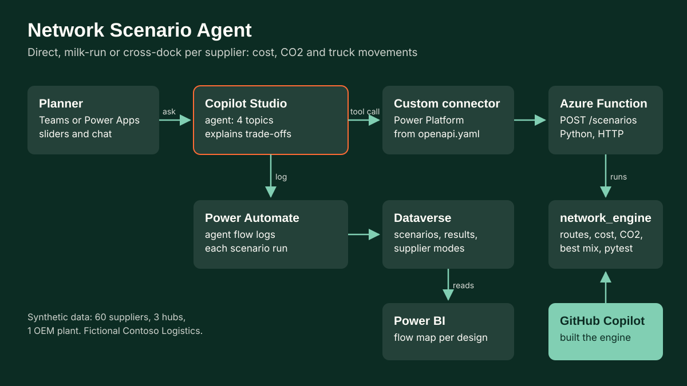

# Network Scenario Agent

A Copilot Studio agent that helps planners at Contoso Logistics (fictional) decide, per supplier, how parts for an automotive OEM plant should travel: direct full-load, regional milk-run or cross-dock consolidation. It calls a network engine through a custom connector, compares cost, CO2 and truck movements, and explains the trade-off in plain words.

[Try the simulated demo](../../site/demos/03-network-scenario-agent.html)

## Problem
An inbound network for a car plant has dozens of supplier lanes. Large suppliers fill trucks and should ship direct. Small suppliers send part loads, which waste capacity and add trucks at the plant gate. Milk-runs pool part loads by region; cross-docks pool distant volume into full line-hauls but add handling. The right answer differs per supplier and moves with diesel price, CO2 price, handling cost and how many stops a milk-run may make. Planners need to test those levers quickly and explain the result to stakeholders.

## Solution
- `src/network_engine/`: pure Python engine (no third-party packages).
  - Synthetic network (seed 3): 60 suppliers in 9 European regions, weekly volume in loading metres (ldm), shipment frequency, tonnes per ldm; one OEM plant in central Germany; three candidate hubs (northern Italy, Czechia, eastern France).
  - Distance: haversine x road factor 1.2.
  - Direct: `freq` shipments a week, each rounded up to whole trucks (13.6 ldm).
  - Milk-run: 5 runs a week; daily volume above whole trailers goes direct, the remainder is pooled by region with nearest-neighbour routes (start at the supplier furthest from the plant, add the nearest one that still fits capacity, up to max stops).
  - Cross-dock: the same daily collection runs end at the hub that minimises supplier to hub to plant distance, then consolidated line-haul at a lower contracted rate, plus handling per ldm.
  - Cost: fixed per trip, per-km rate with a diesel share driven by the fuel index, cost per stop, handling. CO2: kg per vehicle km plus kg per tonne km, built leg by leg as the truck fills.
  - Best mix: seeds from the best single design, an allocation-based pick and (with a CO2 price) the cost-only mix, then accepts single-supplier mode changes that lower cost plus CO2 price. It can never be worse than any single design.
- `src/network_engine/api.py` and `src/function_app.py`: request validation and an Azure Functions (Python v2) HTTP wrapper for `POST /api/scenarios`. Not deployed.
- `openapi.yaml`: OpenAPI 2.0 for the Power Platform custom connector (operation `RunScenario`).
- `copilot-studio/`: agent instructions, four topics (Run a scenario, Compare designs, What if fuel price changes, Explain recommendation), knowledge sources.
- `power-automate/`: agent flow that logs each scenario, its design results and supplier modes to Dataverse.
- `dataverse/schema.md`: tables for scenarios, results, supplier modes and suppliers.
- Demo: `site/demos/03-network-scenario-agent.html`, the engine ported to JavaScript and checked against the Python baseline (`site/demos/data/03-baseline.json`).

## Architecture


| Microsoft component | What it does here |
|---|---|
| Copilot Studio | "Network Scenario Agent": topics, calls the connector as an action, explains trade-offs |
| Power Platform custom connector | Wraps the Azure Function from `openapi.yaml` |
| Azure Functions | Hosts the Python engine behind `POST /scenarios` |
| Power Automate | Agent flow that writes each run to Dataverse |
| Dataverse | Scenario log, design results, per-supplier modes, supplier reference data |
| Power BI | Map visual of supplier flows per design, from Dataverse |
| Power Apps (optional) | Slider front end, same connector |
| GitHub Copilot | Used in VS Code to build the engine, tests and JS port |

## Data
- `data/network.json`, `data/suppliers.csv`: synthetic network from `python -m network_engine.export`.
- `data/baseline_results.csv`: five check scenarios x four designs.
- Baseline (diesel index 1.0, no CO2 price, handling EUR 6/ldm, 4 stops), per week:

| Design | Cost EUR | CO2 t | Truck trips | Plant arrivals |
|---|---:|---:|---:|---:|
| Direct full-load | 222,444 | 89.5 | 209 | 209 |
| Regional milk-run | 173,471 | 69.6 | 135 | 135 |
| Cross-dock | 251,490 | 110.9 | 205 | 100 |
| Best mix (12 direct, 35 milk-run, 13 cross-dock) | 161,210 | 66.2 | 137 | 117 |

Best mix saves 7.1% against the cheapest single design. In this network a CO2 price up to EUR 300/t does not change the mix, because cost and CO2 both follow vehicle km; the agent says so rather than inventing a carbon trade-off. Reducing max stops to 2 makes cross-dock worthwhile for 21 suppliers.

Rates and emission factors are planning assumptions (see `DEFAULT_PARAMS` in `model.py`), not market tariffs.

## Run locally
```
cd projects/03-network-scenario-agent/src
python -m network_engine.export     # data + site/demos/data/03-baseline.json
python -m pytest                    # 22 tests
node verify_js_parity.mjs           # JS port vs Python baseline
```

## Deploy into a tenant
1. **Azure Function**: create a Python 3.11 Function App (Consumption). From `src/`, run `func azure functionapp publish <app-name>` (deploys `function_app.py`, `network_engine/`, `host.json`, `requirements.txt`). Copy a function key.
2. **Custom connector**: Power Apps maker portal > Custom connectors > Import an OpenAPI file > `openapi.yaml`. Set host to your Function App, security API key header `x-functions-key`. Create a connection with the key and test `RunScenario` with `{}`.
3. **Dataverse**: in a solution, create the four tables in `dataverse/schema.md` with publisher prefix `cr_`. Import `data/suppliers.csv` into Supplier.
4. **Power Automate**: in the same solution, build the agent flow from `power-automate/log-scenario-to-dataverse.md` (trigger "When an agent calls the flow").
5. **Copilot Studio**: create agent "Network Scenario Agent", paste `copilot-studio/agent-instructions.md`. Add the connector action `RunScenario` and the flow as tools. Create the four topics, paste each YAML in the code editor, and fix the connection reference names to match your environment. Add knowledge from `copilot-studio/knowledge.md`.
6. **Power BI**: connect to Dataverse, join Supplier Mode to Supplier, use latitude and longitude in a map visual, colour by mode, filter by scenario.
7. Publish the agent to Teams and test the four topics.

## How it was built
- **GitHub Copilot ready:** the repo root holds `.github/copilot-instructions.md`, so Copilot Chat and agent mode pick up the project rules (synthetic data only, tests first, British English, hampy brand) for every follow-up change.
- Drafted with AI pair programming: boilerplate such as the haversine function, routing loop, pytest scaffolding, the OpenAPI schema skeleton and the line-by-line JavaScript port of the Python module.
- Design decisions: the cost and CO2 model (full-truck split, per-leg tonne km, line-haul rate), deterministic tie-breaks so Python and JS build identical routes, and the best-mix search. Picking modes from allocated costs alone can end up worse than a single design once routes are rebuilt, so the search now seeds from the best single design and only accepts improvements, and a test guards it. A first test assumed a CO2 price always lowers emissions; a local search cannot promise that, so the test now checks the property that does hold.
- Parity check: the JS port matches the Python baseline on 80 values with a maximum deviation of 0.00006% (`tests/03_js_parity.txt`).

Inspired by: designed a pan-European inbound network for an automotive OEM plant, comparing direct full-load, regional milk-run and cross-dock designs across 180+ supplier lanes on cost, CO2 and vehicle movements; built an optimisation engine (KNIME and Log-Hub) that routes 40,000 orders across six facilities in around two hours.
