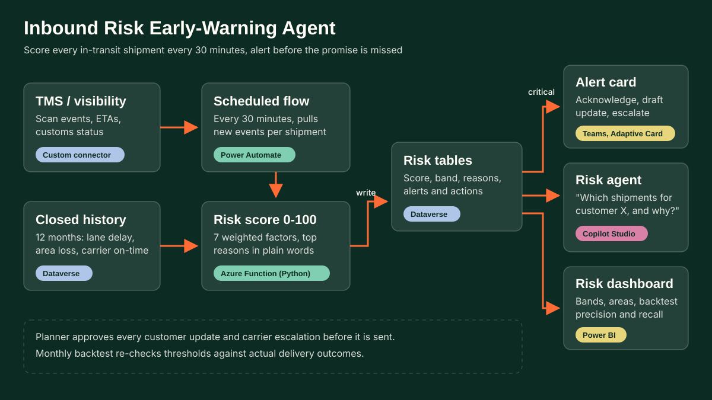

# 04 Inbound Risk Early-Warning Agent

Contoso Logistics, a global port and logistics operator, scores every in-transit inbound shipment every 30 minutes, explains each score in plain words and alerts the control tower in Teams before the promised delivery is missed.

[Try the demo](../../site/demos/04-inbound-risk-agent.html) (static page, synthetic data)

## Problem
Delayed or lost inbound shipments are noticed too late. Tracking data exists, but nobody watches 300 open shipments at once, so customer service often learns about a problem from the customer. By then the options (re-routing, a partial delivery, telling the plant to re-plan) have gone.

## Solution
- **Transparent risk score (0-100)** per in-transit shipment from seven factors. Each factor maps to a 0-1 sub-score on a straight line and is multiplied by a fixed weight; weights add up to 100, so every point is traceable.

| Factor | Weight | No concern | Full concern |
|---|---|---|---|
| Lane historical delay rate | 15 | 6% | 30% |
| Destination postcode-area loss rate | 15 | 0.4% | 2.0% |
| Carrier on-time rate | 15 | 95% | 75% |
| Dwell since last scan vs normal for that scan | 20 | 1x | 3x |
| Customs status | 10 | cleared / not required | held (pending = half) |
| Days to promised delivery minus transit still to run | 20 | 1 day spare | 1 day short |
| Weekend or public holiday before promised date | 5 | none | holiday (weekend only = 0.6) |

- **Bands**: Critical 55+, At risk 40-54, Watch 25-39, On track below 25.
- **Reasons**: the top three factors (3 points or more) as plain sentences, for example "No scan for 79 h since the cross-dock departure scan at Liege cross-dock, 3.9x the usual 20 h".
- **Teams alert**: an Adaptive Card 1.5 (`teams/alert-card.json`) for each new critical shipment with Acknowledge, Draft customer update and Escalate to carrier.
- **Agent**: Copilot Studio answers "which shipments for customer X are at risk and why", drafts customer updates using only customer-safe causes, and prepares carrier escalations. A planner approves everything before it is sent.
- **Backtest**: rates learned on closed shipments before 1 August 2026, then applied to 1,772 later closed shipments and compared with what actually happened.

## Results on the synthetic data (computed by `src/run_pipeline.py`)
- 300 in-transit shipments: 7 critical, 14 at risk, 29 watch, 250 on track.
- Backtest (1,772 shipments, 10.8% actually late):

| Band rule | Flagged | Precision | Recall |
|---|---|---|---|
| Critical | 32 | 96.9% | 16.2% |
| At risk or above | 122 | 77.0% | 49.0% |
| Watch or above | 377 | 37.1% | 72.9% |

- Late rate by band: critical 96.9%, at risk 70.0%, watch 18.0%, on track 3.7%.
- The two seeded high-risk postcode areas (FR-Z07 4.2% and BE-Z03 3.9% loss, network 0.6%) are recovered from history alone and feed the area factor.

Critical is tuned for precision so it can interrupt people; the wider bands trade precision for recall. These numbers describe the synthetic generator, not any real network.

## Architecture


## Microsoft stack
| Component | What it does |
|---|---|
| Power Automate (scheduled cloud flow) | Every 30 minutes: pulls tracking events through a custom connector to the TMS or visibility API, calls the scorer, writes results, posts Teams cards. See `power-automate/scheduled-risk-scan.md` and `.json`. |
| Azure Function (Python) | Runs `risk_model.py` over all open shipments (`src/azure_function/function_app.py`). A Dataverse plug-in (C#) is the alternative if no Azure subscription is allowed. |
| Dataverse | Shipment risk, reasons, scan events, alerts and nightly reference rates (`dataverse/schema.md`). |
| Microsoft Teams | Adaptive Card alerts in the control tower channel; button responses start follow-up flows. |
| Copilot Studio | Inbound Risk Agent with four topics (`copilot-studio/topics/`), grounded on Dataverse and two SharePoint pages. |
| Power BI | Risk dashboard: band counts, at-risk shipments by customer and carrier, area loss ranking, monthly backtest page. |
| GitHub Copilot | Used while writing the generator, model, tests and the JS port (see below). |

## Data
All synthetic, seeded (`SEED = 404`), regenerated by `python src/run_pipeline.py`:
- `data/history_snapshots.csv`: 7,200 closed shipments over 12 months, each with a mid-transit snapshot and the real outcome (late, lost). Outcomes come from a hidden process that differs from the scoring weights, so the backtest is a fair test.
- `data/scan_events.csv`, `data/scored_shipments.csv`: 300 in-transit shipments as of Mon 9 Nov 2026 08:00, their scan events, scores and reasons.
- `data/lanes.csv`, `data/areas.csv`, `data/carriers.csv`, `data/reference_rates.json`: 12-month rates.
- `data/backtest.json`: confusion counts, precision and recall per band rule.
- Carrier and customer names are Microsoft sample company names; postcode areas are made-up zone codes.

## Run locally
```
cd projects/04-inbound-risk-agent
python src/run_pipeline.py      # data, scores, backtest, alert card, demo data
python -m pytest -q             # 28 tests, includes the JS parity check if node is installed
node src/verify_js_parity.js    # JS port vs Python: scores, bands, reasons, card
```

## Deploy into a tenant
1. **Dataverse**: create a solution with publisher prefix `cr`, add the tables in `dataverse/schema.md`, import `data/*.csv` with Dataverse import for a test run.
2. **Azure Function**: create a Python 3.11 Function App, copy `risk_model.py` and `alert_card.py` next to `function_app.py`, deploy, turn on a system-assigned managed identity and Entra authentication.
3. **Custom connector**: build it from your visibility provider's OpenAPI file; you need one operation that returns events since a timestamp.
4. **Flows**: create the scheduled flow from `power-automate/scheduled-risk-scan.md` (the `.json` shows the shape), the card-response flow and the three agent flows in `power-automate/agent-actions.md`. Use connection references so the solution moves between environments.
5. **Teams**: create a "Control tower" channel; set its team and channel ids in the flow. Post `teams/alert-card.json` once from the flow to check it renders.
6. **Copilot Studio**: create the agent, paste `copilot-studio/agent-instructions.md`, add the knowledge sources in `knowledge.md`, create the four topics (code editor, paste the YAML) and bind each `InvokeFlowAction` to the flows from step 4.
7. **Power BI**: connect to Dataverse, build the dashboard pages and schedule refresh after the nightly reference-rate job.
8. **Calibrate** before go-live: run the backtest on your own closed shipments and set thresholds so the critical band has the precision your control tower needs.

## How it was built
- **GitHub Copilot ready:** the repo root holds `.github/copilot-instructions.md`, so Copilot Chat and agent mode pick up the project rules (synthetic data only, tests first, British English, hampy brand) for every follow-up change.
- Drafted with AI pair programming: boilerplate such as the CSV writers, pytest parametrisation, the Adaptive Card skeleton and the line-by-line JS port of the scoring functions.
- Design decisions: factor choice, weights and the straight-line sub-scores; the out-of-time backtest split, so rates used in the test never see test outcomes; half-up rounding in both languages so Python and JS give identical reason text (enforced by the parity test); the customer-safe wording rule that keeps carrier and area statistics out of customer emails; threshold calibration against the backtest.

Inspired by: inbound-risk dashboard sustaining 99% on-time through COVID-19; lost-shipment postcode analysis cutting lost shipments 64%.
