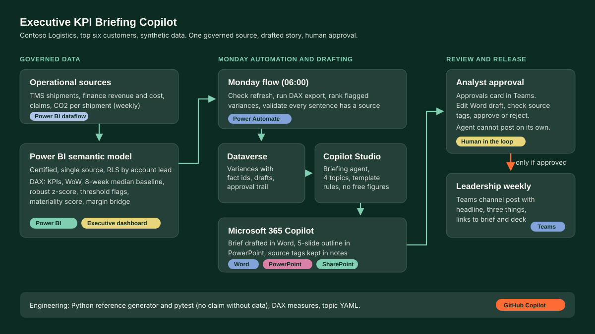

# 05 Executive KPI Briefing Copilot

Turns the weekly KPI dashboard for the top six customers into a short, traceable story: a brief in Word, a five-slide outline in PowerPoint and a Teams post, drafted on Monday morning and released only after an analyst approves.

Fictional company: Contoso Logistics, a global port and logistics operator. All customers and figures are synthetic.

[Try the demo](../../site/demos/05-kpi-briefing-copilot.html)

## Problem
Leadership gets dashboards but not the story. Every Monday an analyst reads the account dashboard, works out what moved, decides what matters and writes the weekly account brief by hand. It is slow, it varies by author, and numbers in the text drift from the numbers in the dashboard.

## Solution
- **One governed source.** A certified Power BI semantic model holds the weekly KPIs for six top customers: volume, revenue, cost to serve per shipment, margin %, on-time %, claims and CO2 per shipment.
- **Variance engine.** Week on week and against an eight-week baseline (median of the previous eight weeks), with a robust z-score (1.4826 x MAD). A variance is flagged only when it breaches the KPI threshold **and** abs(z) >= 2.
- **Materiality ranking.** `min(abs(z), 8) x KPI weight x sqrt(revenue share x 6)`. High >= 5, Medium >= 3, else Low. Large customers and money KPIs rise to the top; noise does not.
- **Narrative generator.** Template rules write the headline, three things that matter, one callout per customer, up to four actions, a five-slide outline and a Teams post in plain British English.
- **No claim without data.** Every sentence carries `refs` to facts; each fact maps to a named DAX measure. A validator rejects any sentence without a source or with a number that is not in its referenced facts. The flow blocks the draft if validation fails.
- **Human approval.** The agent drafts; an analyst approves in Teams before anything reaches the leadership channel.

## Architecture


## Microsoft stack

| Component | What it does here |
|---|---|
| Power BI semantic model | Single governed source. DAX measures for KPIs, WoW, baseline, z-score, flags, materiality and the margin bridge (`powerbi/measures.dax`, `powerbi/semantic-model.md`) |
| Power BI report | Executive dashboard with the same measures, so the brief and dashboard always agree |
| Power Automate | Monday 06:00 flow: checks refresh, runs the DAX export, ranks variances, validates the draft, creates files, runs the approval, posts to Teams (`power-automate/`) |
| Dataverse | Stores flagged variances with fact ids, generated drafts and the approval trail (`dataverse/schema.md`) |
| Copilot Studio | Briefing agent with four topics: Weekly brief, Why did margin move for customer X, Build slide outline, Compare customers (`copilot-studio/`) |
| Microsoft 365 Copilot | Polishes the brief in Word and designs slides from the outline in PowerPoint; source tags stay in speaker notes |
| Teams + Approvals | Analyst approval card; approved summary posted to the Leadership weekly channel |
| SharePoint | Word template, brief and deck files, KPI definitions and style guide used as agent knowledge |

## Data
- `src/briefing.py` generates the dataset (seed 505): 6 fictional customers x 26 weeks (2026-W14 to 2026-W39), written to `data/kpi_weekly.csv`.
- Seeded events: Fabrikam Steel margin dip (cost to serve +6.5%, W31 to W33), Tailspin Retail on-time drop (about 6 pp, claims up, W35 to W36), Northwind Automotive volume surge (+28%, W38 to W39).
- Outputs: `data/variances_flagged.csv` (all weeks), `data/brief_2026-W39.md` (brief with a sources list), and `site/demos/data/05-kpi-briefing.json` / `.js` (every week's facts, variances, brief, slides, Teams post and margin bridges for the demo).
- Result on this data: 18 weeks briefed (W22 to W39), 756 customer x KPI checks, 20 flagged, 12 High. All three seeded events are detected and ranked first in their weeks; no quiet week produces a High flag. 420 generated sentences, all traced to facts.

Run:

```bash
cd projects/05-kpi-briefing-copilot
python src/briefing.py
python -m pytest
```

Tests (`tests/test_briefing.py`, 17 tests): dataset shape and reproducibility, variance maths, seeded event detection, materiality ranking order, weight, size and cap, tie-breaks, the no-claim-without-data validator (positive and negative cases), facts match the dataset, brief structure, margin bridge adds up.

## Deploy into a tenant
1. **Semantic model.** Load `data/kpi_weekly.csv` (or your dataflow) into Power BI Desktop as `FactWeeklyKPI`; build `DimCustomer`, `DimWeek` (with contiguous `WeekIndex`) and `Thresholds` as in `powerbi/semantic-model.md`. Paste the measures from `powerbi/measures.dax`. Publish to a workspace, endorse as Certified, set RLS.
2. **Service principal.** Register an app in Entra ID, allow service principals in the Power BI admin portal, give it Build on the dataset.
3. **Dataverse.** In a solution, create the tables in `dataverse/schema.md` with the two security roles.
4. **SharePoint.** Upload `Weekly brief.dotx` (content controls: headline, summary, things, callouts, actions, sources), the KPI definitions and the style guide.
5. **Flows.** Build the Monday flow and the four child flows from `power-automate/monday-kpi-brief-flow.md` (sketch in `.json`). Set connection references to the service principal, Dataverse, Word, Approvals and Teams.
6. **Agent.** In Copilot Studio create the agent, paste `copilot-studio/agent-instructions.md`, add the SharePoint knowledge from `knowledge.md`, switch off general knowledge, and import the four topics from `copilot-studio/topics/` (code editor, paste YAML). Add a closed list entity `TopSixCustomers`. Bind each `InvokeFlowAction` to its child flow.
7. **Publish** to Teams and Microsoft 365 Copilot. Restrict access to the commercial analyst group.
8. **Test** with the synthetic CSV: W32 should flag Fabrikam Steel cost to serve and margin as High, W35 Tailspin Retail on-time as High, W39 Northwind Automotive revenue and volume as High.

## How it was built
- **GitHub Copilot ready:** the repo root holds `.github/copilot-instructions.md`, so Copilot Chat and agent mode pick up the project rules (synthetic data only, tests first, British English, hampy brand) for every follow-up change.
- **Drafted with AI pair programming:** the first pass of the dataset generator loops, CSV writer, the DAX measure pattern repeated across KPIs, the topic YAML skeletons, and most of the demo's rendering functions.
- **Design decisions:** the baseline method (switched from mean and standard deviation to median and MAD after the first event week hid the second), the materiality formula and thresholds (tuned so quiet weeks do not raise High flags), the sentence validator and the decision to make every sentence carry refs, the margin bridge so the two effects add up exactly, the British English wording and the "flat" rule for changes that round to zero, and the approval gate in the flow.
- **Checked by tests:** pytest covers ranking and traceability; demo numbers are rendered from the Python export, not typed in.

Inspired by: executive Power BI dashboards consolidating the top six global customers into a single KPI view, and leading the analytics workstream that consolidated fragmented operational reporting into governed, single-source datasets.
