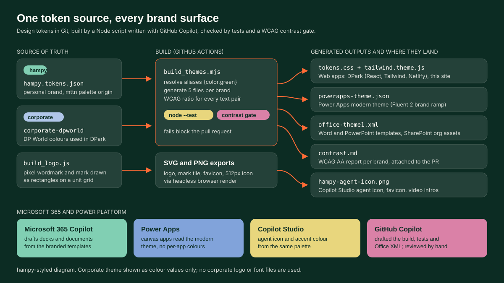

# AI Brand Theme Systems

One design-token file per brand drives logos, web apps, Word and PowerPoint templates, Power Apps themes and Copilot Studio agent icons. Two cases: the **hampy** personal brand, and a **corporate theme (DP World)** applied to DPark, an internal staff parking booking app.

Try it: [`site/demos/06-brand-theme-systems.html`](../../site/demos/06-brand-theme-systems.html)



## Problem
Brand colours get copied by hand into every new thing: a React app, a Power Apps screen, a PowerPoint deck, a Copilot Studio agent. Each copy drifts a little. A pink becomes a slightly different pink, a button loses contrast, a deck uses the default Office blue because nobody installed the theme. With Microsoft 365 Copilot now drafting documents and decks, drift scales: Copilot builds on whatever template it is given.

## Solution: one source, generated outputs
```
src/tokens/<brand>.tokens.json  ->  node src/build_themes.mjs  ->  dist/<brand>/
                                                                   tokens.css
                                                                   tailwind.theme.js
                                                                   powerapps-theme.json
                                                                   office-theme1.xml
                                                                   contrast.md
```
- **Tokens** follow the W3C design-tokens format (`$value`, `$type`, aliases such as `{color.green}`). A `palette` layer holds raw colours; a `role` layer (canvas, surface, text, accent, onAccent, success, warning, danger, info) is what apps use. `$extensions` holds the Office colour-slot mapping, the Power Apps brand base and the text/background pairs to test.
- **Build** (`src/build_themes.mjs`, Node 24, no dependencies) resolves aliases, detects cycles and writes five files per brand, plus `dist/specimen.html` and the demo data file `site/demos/data/06-themes.js`.
- **Contrast** uses the WCAG 2.x relative luminance formula. Each pair is graded AAA, AA, AA large only or fail. Pairs the brand guide bans (offwhite on orange or lime) are marked `expectFail` and the build proves they fail.
- **Logo**: the hampy wordmark, mark and agent icon are drawn in code by `build_logo.js` in the hampy brand kit: each glyph is a list of rectangles on a unit grid (2-unit stroke, 10-unit x-height), cursor always orange. Exports go to SVG and, through a headless browser, to PNG (512px agent icon, 64px favicon).

Run:
```
node src/build_themes.mjs          # all brands
node --test                        # 7 tests: contrast maths, grading, aliases, ramp, output shape
```

## Results (computed by the build)
| Brand | Pairs checked | Unexpected fails | Notes |
|---|---|---|---|
| hampy | 11 | 0 | Green ink on every bright fill passes AA (5.29 to 10.25:1). Banned pairs fail: offwhite on orange 2.79:1, on lime 1.79:1. |
| Corporate theme: DP World | 10 | 4 | White on accent `#ff2261` 3.71:1 and accent text on white 3.71:1 pass for large text only; white on success `#00b86f` 2.60:1 fails; white on warning 3.19:1 large only. |

The corporate findings are reported, not "fixed": the palette is not mine to change. The demo picks chip ink by contrast (indigo ink on green, amber and accent fills), and DPark keeps the accent button label bold uppercase.

## The two cases
**hampy (personal brand).** Palette from the mttn soft palette, own pixel wordmark and orange cursor mark. The same tokens style this portfolio site, every demo page, video title cards and the Copilot Studio agent icon used across the demos.

**Corporate theme: DP World in DPark.** DPark is a staff parking booking app (React, Tailwind, Netlify Functions). Its `tailwind.config.ts` maps class names to CSS variables holding RGB channel triples, so `bg-accent/10` works and one block re-themes light and dark. `corporate-dpworld.tokens.json` captures those values (including the dark mode overrides under `$extensions.modes.dark`), and the generated `tokens.css` reproduces the light and dark blocks. Only colour values and token names are used here: no corporate logo, DPark mark or Pilat font files are copied or published. Font tokens name Pilat, and the browser falls back to Segoe UI or Arial.

## Microsoft stack: where each output lands
| Output | Component | What it does |
|---|---|---|
| `office-theme1.xml` | Word, PowerPoint, SharePoint organisation assets library | DrawingML theme: 12 colour slots (dk1, lt1, dk2, lt2, accent1 to 6, hlink, folHlink) and a heading/body font pair. Replace `ppt/theme/theme1.xml` or `word/theme/theme1.xml` in a `.potx` / `.dotx`, publish the template to the organisation assets library. |
| same templates | Microsoft 365 Copilot | When a user starts from the branded template, Copilot in PowerPoint and Word builds new slides and pages on that theme, so generated charts, headings and accents use brand colours instead of Office defaults. |
| `powerapps-theme.json` | Power Apps (modern controls, Fluent 2) | A 16-step Fluent 2 brand ramp (10 to 160, brand base at 80) plus overrides for neutral, brand and status colours. Apply it as a custom theme where the tenant allows it, or load the hex values into a named formula in `App.Formulas` and bind controls to it. |
| `hampy-agent-icon.png`, role colours | Copilot Studio | The agent icon is uploaded in the agent details; the Teams channel accent colour uses `role.accent` or `role.surface`. Adaptive cards in topics use the same role hex values. |
| `tokens.css`, `tailwind.theme.js` | Web apps (React, static sites) | CSS custom properties or a Tailwind preset; DPark and this site consume them. |
| `contrast.md`, `node --test` | GitHub Actions (`ci/theme-build.yml`) | Rebuilds on every tokens change, fails the PR on an unexpected contrast fail or on uncommitted generated files. |

## Deploy into a tenant
1. Put this folder in a GitHub repo and copy `ci/theme-build.yml` to `.github/workflows/`.
2. Edit a `*.tokens.json`, open a pull request, let the workflow rebuild and test.
3. Word and PowerPoint: open the corporate `.potx` / `.dotx` (rename to `.zip`), replace `theme/theme1.xml` with `dist/<brand>/office-theme1.xml`, save, upload to the SharePoint site registered as the organisation assets library (`Add-SPOOrgAssetsLibrary -OrgAssetType OfficeTemplateLibrary`).
4. Power Apps: import `powerapps-theme.json` as a custom theme, or paste the palette into `App.Formulas` and reference it from control properties.
5. Copilot Studio: upload the 512px agent icon in the agent details and set the channel accent colour from `role.accent`.
6. Web apps: add `tailwind.theme.js` to `presets` in `tailwind.config`, or link `tokens.css`.

## Files
- `src/tokens/hampy.tokens.json`, `src/tokens/corporate-dpworld.tokens.json`: sources.
- `src/build_themes.mjs`: generator. `tests/build_themes.test.mjs`: `node --test`.
- `dist/hampy/*`, `dist/corporate-dpworld/*`, `dist/specimen.html`: committed outputs.
- `src/specimen/logo_grid.html`: page used to capture the logo grid image. The DPark image was cropped from internal screenshots with logos and names removed; the capture page is not published.
- `ci/theme-build.yml`: GitHub Actions workflow.

## How it was built
- **GitHub Copilot ready:** the repo root holds `.github/copilot-instructions.md`, so Copilot Chat and agent mode pick up the project rules (synthetic data only, tests first, British English, hampy brand) for every follow-up change.
- **Drafted with AI pair programming:** the alias resolver and flattening walk, the first version of the WCAG luminance and ratio functions, the DrawingML `clrScheme` / `fontScheme` skeleton, the Tailwind preset wrapper and most of the test cases.
- **Design decisions:** the sRGB threshold and grading bands (checked against the known 4.54:1 for `#767676` on white), the `expectFail` idea for banned pairs, a minimal valid `fmtScheme` so Office opens the theme, the Fluent ramp rule (base at 80), the choice of which corporate pairs to test, and every IP decision (no logos, no font files, covered screenshots).

Inspired by: Build my own analytical tools and automations to speed up day-to-day work.
