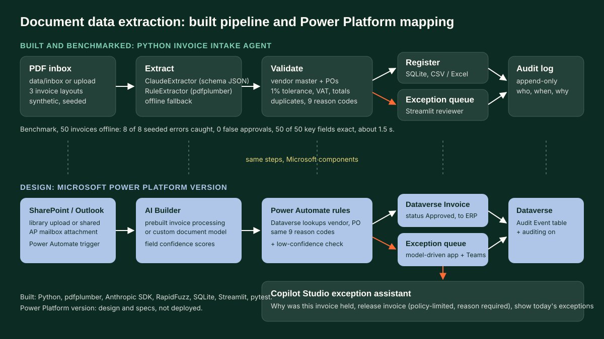

# Document data-extraction models

**PDF invoices in, a checked register out. People only see the exceptions.**

## Problem

Accounts payable teams still open supplier PDFs and key the vendor, invoice number, PO and amounts by hand. At about three minutes per invoice that is days of work every month, and every manual step can go wrong.

## What was built (Python, working and benchmarked)

The **Invoice Intake Agent** is a working Python app (source available on request; there is no public repository).

1. **Read** each PDF into structured fields: vendor, VAT number, invoice number, date, PO, currency, net, VAT, total.
   - `ClaudeExtractor`: schema-validated JSON through the Anthropic SDK when an API key is set.
   - `RuleExtractor`: pdfplumber plus label patterns. Used offline, and as the fallback if the API errors or declines.
   - Both return the same Pydantic `InvoiceFields` model, so the rest of the pipeline never cares how fields were read.
2. **Check** every invoice against the vendor master and purchase orders with deterministic controls and reason codes: `EXTRACTION_INCOMPLETE`, `UNKNOWN_VENDOR`, `MISSING_PO`, `PO_NOT_FOUND`, `PO_VENDOR_MISMATCH`, `AMOUNT_MISMATCH` (net more than 1% from the PO), `VAT_MISMATCH` (not 21%, 9% or 0% of net), `TOTAL_MISMATCH`, `DUPLICATE`.
3. **Route** clean invoices to the register automatically; everything else goes to an exception queue with the reason in plain words.
4. **Record** every automatic and human decision in an append-only audit log (who, when, why). One database commit per batch.

| Module | Role |
|---|---|
| `intake/generate.py` | Synthetic vendor master, POs and PDF invoices in three layouts, about 16% seeded errors, ground-truth file |
| `intake/extract.py` | `ClaudeExtractor` and `RuleExtractor` |
| `intake/validate.py` | The controls and reason codes |
| `intake/store.py` | SQLite register and audit log |
| `intake/pipeline.py` | Batch run and time-saved calculation |
| `app.py` | Streamlit UI: run intake, register, exception queue, audit log |

Stack: Python, Streamlit, pdfplumber, ReportLab, RapidFuzz, SQLite, pandas, Altair, Pydantic, Anthropic SDK, pytest (13 tests in the source repo).

### Results

Re-run for this portfolio on 2026-10-20 with `python -m intake.benchmark --n 50 --offline` (rule-based extractor, output saved to `Copilot-Logistics-Portfolio/tests/07_benchmark.txt`):

| Measure | Result |
|---|---|
| Invoices processed | 50 in 1.4 s (0.03 s each) |
| Auto-approved / exceptions | 42 / 8 (8 seeded) |
| Seeded errors caught | 8 of 8, each with the correct reason |
| False approvals / false exceptions | 0 / 0 |
| Key fields read exactly | 50 of 50 across three layouts |
| Time saved | about 142 of 150 minutes of manual keying |

Time saved assumes 3 minutes to key an invoice and 1 minute to review an exception. The invoices are synthetic and generated by the repo, so results on real supplier documents will differ. The Claude extractor path was not part of this benchmark run.

### Design choices

- Human in the loop by default: nothing is approved unless every control passes.
- AI where it helps, rules where they are enough: the model reads messy layouts, the controls stay deterministic and testable.
- Safe fallback: without a key, or on API errors, the rule-based reader completes the batch.
- Controls as data: tolerance, VAT rates and master data are configuration, so the same engine can match delivery notes, receipts or bank lines.

## Microsoft Power Platform version (design, not deployed)

To be clear about status: the Python app is built and measured. The Power Platform version below is a design and specification I wrote to show how the same controls map to Microsoft components. It has not been deployed to a tenant, and no AI Builder accuracy figures are claimed.

| Python step | Power Platform component | Spec |
|---|---|---|
| PDF inbox | SharePoint library or Outlook shared mailbox trigger | [flow-invoice-intake.md](power-platform/flow-invoice-intake.md) |
| `ClaudeExtractor` / `RuleExtractor` | AI Builder invoice processing (prebuilt) or custom document processing model | [ai-builder-model.md](power-platform/ai-builder-model.md) |
| `validate.py` | Power Automate conditions with Dataverse lookups, same reason codes, plus a low-confidence rule | [flow-invoice-intake.md](power-platform/flow-invoice-intake.md) |
| SQLite register and audit log | Dataverse tables, auditing enabled | [dataverse/schema.md](power-platform/dataverse/schema.md) |
| Streamlit exception queue | Model-driven app view plus Teams adaptive card | [flow-invoice-intake.md](power-platform/flow-invoice-intake.md) |
| (new) | Copilot Studio exception assistant | [copilot-studio/topics/](power-platform/copilot-studio/topics/) |

What changes in the move:

- **Confidence becomes a control.** AI Builder returns a confidence per field; the flow adds `LOW_CONFIDENCE` when a required field scores under the threshold. The Python rule reader has no confidence score, so it relies on `EXTRACTION_INCOMPLETE` instead.
- **Release policy.** The assistant may release only `AMOUNT_MISMATCH`, `MISSING_PO` and `PO_NOT_FOUND`, always with a reason. Duplicates, unknown vendors, VAT and total errors and PO-vendor mismatches need a person in the model-driven app. The Python app lets the reviewer approve anything with a comment.
- **Fuzzy vendor match.** RapidFuzz `token_sort_ratio >= 90` has no direct Power Automate equivalent; the design matches on VAT number first, then exact normalised name, and sends the rest to `UNKNOWN_VENDOR`.

### Deploying into a tenant (outline)

1. Create a solution and import the Dataverse tables in `power-platform/dataverse/schema.md`; load vendors and open POs.
2. In AI Builder, test the prebuilt invoice model on 20 to 30 real invoices; build a custom document processing model only if key fields miss (see `ai-builder-model.md`).
3. Create connection references (SharePoint, Office 365 Outlook, Dataverse, AI Builder, Teams) and build the flow from `flow-invoice-intake.md`.
4. Generate a model-driven app on the Invoice and Audit Event tables with an "Open exceptions" view.
5. Create the Copilot Studio agent, add the three topics from `copilot-studio/topics/` and their Dataverse actions, publish to Teams.
6. Run the synthetic set through, compare against the ground truth, then pilot on one supplier group.

## Demo

`site/demos/07-document-extraction.html` simulates an intake run over 12 invoices from the app's synthetic set (`data/sample_invoices.json`). The validation logic is a port of `validate.py` running in the browser, so the 4 approvals and 8 exceptions are computed, not typed in. Confidence values on that page are illustrative.

## How it was built

Developed with AI pair-programming, not with GitHub Copilot. The figures above come from a fresh benchmark run, not from the original write-up. The Power Platform specs in `power-platform/` were written for this portfolio.

Inspired by: P&O integration analytics into governed single-source datasets.
