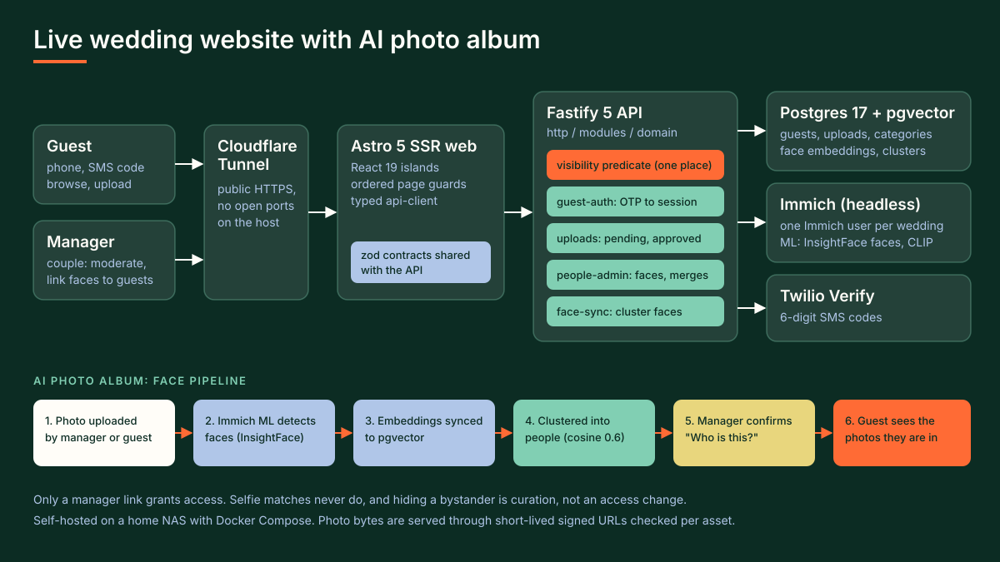

# Live Wedding Website with AI Photo Album

A private wedding website where guests sign in with their phone number and see the photos their access allows, including the photos face recognition finds them in. The couple (managers) upload, moderate and organise photos, and confirm who each detected person is.

- Status: in production at `https://wedding.mttndgtl.com` (invite-only, phone sign-in), self-hosted on a home NAS.
- Code: private repository (GitHub, `Mitten-Digital-Solutions/wedding-photos`).
- Demo: [28 s walkthrough clip](../../site/media/08/clip.mp4), cut from an 86 s product video. The video runs the real production web build against a mock API with sample photos and fictional names ("Alex & Jordan", `+1 555` numbers).

## What the platform does

- **Guest sign-in by SMS.** A guest enters the phone number the couple invited, receives a 6-digit Twilio Verify code and gets an HttpOnly session cookie. No passwords for guests.
- **Gallery.** Guests browse approved photos in a grid and lightbox. The lightbox shows who is in each photo.
- **People.** A directory of the people found across the photos; a guest's own cluster shows as "Me".
- **Guest uploads.** Guests add their own photos. They queue as pending until a manager approves them.
- **Manager tools.** Approve, reject or hide photos, mark highlights, create custom categories, manage guests and their access, and review faces.
- **Faces: "Who is this?"** One card per detected person. A manager links the person (or some of their faces) to a guest, merges look-alikes, or hides bystanders in bulk.

## Architecture

pnpm and Turborepo monorepo, TypeScript throughout.

| Part | Technology | Role |
|---|---|---|
| Web | Astro 5 SSR, React 19 islands, Tailwind | Server-rendered pages with ordered page guards; every call goes through a typed API client |
| API | Fastify 5 | Layered as `http/`, `modules/<area>/`, `domain/`, `integrations/` |
| Contracts | zod 4 (`@wp/contracts`) | One set of request and response schemas shared by API, client and web |
| Database | Postgres 17 + pgvector, Drizzle ORM | Guests, uploads, categories, face embeddings and person clusters |
| Photo backend | Immich (headless), one Immich user per wedding | Storage, thumbnails, EXIF; its ML service runs InsightFace (faces) and CLIP |
| Sign-in | Twilio Verify | SMS one-time codes for guests and managers; argon2id passwords for the platform admin only |
| Hosting | Docker Compose on a NAS, Cloudflare Tunnel | Public HTTPS with no open inbound ports |

Photo bytes are not proxied through the API: the API authorises each request and mints a short-lived signed URL per asset.

## The AI part

1. A photo is uploaded by a manager or a guest and stored in the wedding's own Immich user.
2. Immich's machine-learning service detects faces with InsightFace and produces an embedding per face.
3. A face-sync job copies the faces and embeddings into Postgres (pgvector, HNSW index).
4. Each face is assigned to the nearest person cluster when cosine similarity reaches 0.6 (`ATTRACT_THRESHOLD`), otherwise it starts a new cluster; cluster centroids are updated as faces join.
5. A manager opens a person card ("Who is this?") and links it to a guest, merges it with another person, or hides it as a bystander. Suggestions are ranked by similarity ("possible matches").
6. A guest then sees the photos they appear in, on top of any categories the manager granted them.

The design sets expectations honestly: wedding conditions (side profiles, veils, low light) limit recall, so the copy says "photos we think include you", not "all your photos".

## Privacy design

- **One access predicate.** `domain/access/visibility.ts` is the only place that decides which photos a viewer may see. Admins, managers and guests granted "All photos" see every approved photo; other guests see the union of photos a manager linked them to and the categories they were granted. No grants means no photos.
- **Only a manager link grants access.** Selfie matches never grant access, and hiding a person is curation, not an access change.
- **No existence leaks.** Per-asset checks return 404 for photos a viewer may not see, so a signed URL copied from another guest reveals nothing.
- **Tenant isolation.** Each wedding is its own Immich user, so a guest at two weddings is never merged into one person across them.
- **Consent.** The original design requires explicit opt-in for face recognition, separate from general terms (`face_consent_at`). The selfie "find me" flow is switched off by default (`FIND_ME_ENABLED`).
- **Retention.** Face data is kept while the gallery is online and removed by admin action; deleting a photo erases its face rows. The planned 90-day automatic purge was dropped by a recorded decision, and the backlog lists the remaining gap (a guest self-service "delete my face data" route) openly.
- **Moderation.** Guest uploads stay pending until a manager approves them.

## Key decisions (ADRs)

Nine accepted architecture decision records, written during a whole-app refactor:

| # | Decision, in short |
|---|---|
| 0001 | Refactor without changing behaviour, proven by characterization tests |
| 0002 | ESLint 9 and Prettier 3 with an exact lint-warning ratchet in CI |
| 0003 | zod schemas in `@wp/contracts` are the single wire contract |
| 0004 | Typed API client: resource modules over one request core |
| 0005 | API layering (`http`, `modules`, `domain`, `integrations`) and one error-handling path |
| 0006 | Route validation in zod that reproduces Fastify's Ajv coercion exactly |
| 0007 | Web foundations: typed client, ordered page guards, copy by error code |
| 0008 | Web feature folders with part snapshots |
| 0009 | Phased merges behind one deploy and a release gate |

CI runs format check, lint, the warning ratchet, typecheck, tests, deploy-script tests and a build on every push.

## How it was built: AI pair programming

Built with an AI coding agent as pair programmer, not GitHub Copilot. The working method is visible in the repo:

- **Spec first.** 12 design specs and 46 implementation plans under `docs/superpowers/` (brainstorm, then spec, then a step-by-step plan) before code was written.
- **Agent instructions in the repo.** `AGENTS.md` and `CLAUDE.md` hold the stack, house rules and gotchas, so any agent (Copilot agent mode reads the same kind of file) starts with the same context.
- **Tests as the guard rail.** House rule: TDD, write the failing test first; every public function has a test (142 test files). Characterization snapshots pin behaviour, so a snapshot change is treated as a behaviour change in its own commit.
- **Human decisions.** Scope, privacy rules, thresholds and the release gate were decided by hand and recorded as ADRs; the agent drafted code, tests and docs against them, and CI gates every push.

The same workflow transfers directly to GitHub Copilot: repository custom instructions, Copilot agent mode on a spec, and pull requests gated by the same CI.

## Microsoft stack equivalent (design mapping, not built)

How the same product would map onto Microsoft services. This is a design exercise; none of it was built.

| This build | Microsoft equivalent | Note |
|---|---|---|
| Immich storage and thumbnails | Azure Blob Storage, Azure Functions for thumbnails | Private containers, SAS URLs replace the signed pixel URLs |
| InsightFace face detection and clustering | Azure AI Face | **Limited Access**: face identification, grouping and verification need an approved Microsoft application, so a production build depends on that approval |
| CLIP search and tagging | Azure AI Vision (image analysis: tags, captions) | Category suggestions and search, no identity |
| Twilio Verify guest sign-in | Microsoft Entra External ID | Invited guests sign in with an email one-time passcode, SMS as a second factor |
| Upload moderation notifications | Power Automate | Notify the couple in Teams or email when an upload is pending |
| Postgres + pgvector | Azure Database for PostgreSQL with pgvector | Same schema and access predicate |
| Docker on NAS + Cloudflare Tunnel | Azure Container Apps | Managed HTTPS ingress |

## Photo credits

Sample photos in the demo video and screenshots are from Wikimedia Commons. People shown are from openly licensed photos; all names in the demo are fictional.

| File | Source | Author | Licence |
|---|---|---|---|
| p01.jpg | [22, Bridal bouquet (Unsplash).jpg](https://commons.wikimedia.org/wiki/File:22,_Bridal_bouquet_(Unsplash).jpg) | Alvin Mahmudov alvinmahmudov | CC0 |
| p02.jpg | [BethsWeddingReception-3287 (8298423185).jpg](https://commons.wikimedia.org/wiki/File:BethsWeddingReception-3287_(8298423185).jpg) | John Trainor from Roswell, GA, USA | CC BY 2.0 |
| p03.jpg | [BethsWeddingReception-3290 (8298426121).jpg](https://commons.wikimedia.org/wiki/File:BethsWeddingReception-3290_(8298426121).jpg) | John Trainor from Roswell, GA, USA | CC BY 2.0 |
| p04.jpg | [BethsWeddingReception-3291 (8298428827).jpg](https://commons.wikimedia.org/wiki/File:BethsWeddingReception-3291_(8298428827).jpg) | John Trainor from Roswell, GA, USA | CC BY 2.0 |
| p05.jpg | [BethsWeddingReception-3292 (8298430397).jpg](https://commons.wikimedia.org/wiki/File:BethsWeddingReception-3292_(8298430397).jpg) | John Trainor from Roswell, GA, USA | CC BY 2.0 |
| p06.jpg | [BethsWeddingReception-3307 (8299512082).jpg](https://commons.wikimedia.org/wiki/File:BethsWeddingReception-3307_(8299512082).jpg) | John Trainor from Roswell, GA, USA | CC BY 2.0 |
| p07.jpg | [BethsWeddingReception-3322 (8298468115).jpg](https://commons.wikimedia.org/wiki/File:BethsWeddingReception-3322_(8298468115).jpg) | John Trainor from Roswell, GA, USA | CC BY 2.0 |
| p08.jpg | [BethsWeddingReception-3354 (8299551014).jpg](https://commons.wikimedia.org/wiki/File:BethsWeddingReception-3354_(8299551014).jpg) | John Trainor from Roswell, GA, USA | CC BY 2.0 |
| p09.jpg | [BethsWeddingReception-3452 (8298589673).jpg](https://commons.wikimedia.org/wiki/File:BethsWeddingReception-3452_(8298589673).jpg) | John Trainor from Roswell, GA, USA | CC BY 2.0 |
| p10.jpg | [BethsWeddingReception-3467 (8298593259).jpg](https://commons.wikimedia.org/wiki/File:BethsWeddingReception-3467_(8298593259).jpg) | John Trainor from Roswell, GA, USA | CC BY 2.0 |
| p11.jpg | [BethsWeddingReception-3494 (8299176695).jpg](https://commons.wikimedia.org/wiki/File:BethsWeddingReception-3494_(8299176695).jpg) | John Trainor from Roswell, GA, USA | CC BY 2.0 |
| p12.jpg | [BethsWeddingReception-3497 (8299183913).jpg](https://commons.wikimedia.org/wiki/File:BethsWeddingReception-3497_(8299183913).jpg) | John Trainor from Roswell, GA, USA | CC BY 2.0 |
| p13.jpg | [BethsWeddingReception-3499 (8299192381).jpg](https://commons.wikimedia.org/wiki/File:BethsWeddingReception-3499_(8299192381).jpg) | John Trainor from Roswell, GA, USA | CC BY 2.0 |
| p14.jpg | [BethsWeddingReception-3500 (8300248578).jpg](https://commons.wikimedia.org/wiki/File:BethsWeddingReception-3500_(8300248578).jpg) | John Trainor from Roswell, GA, USA | CC BY 2.0 |
| p15.jpg | [BethsWeddingReception-3504 (8299200299).jpg](https://commons.wikimedia.org/wiki/File:BethsWeddingReception-3504_(8299200299).jpg) | John Trainor from Roswell, GA, USA | CC BY 2.0 |
| p16.jpg | [BethsWeddingReception-3506 (8299204491).jpg](https://commons.wikimedia.org/wiki/File:BethsWeddingReception-3506_(8299204491).jpg) | John Trainor from Roswell, GA, USA | CC BY 2.0 |
| p17.jpg | [BethsWeddingReception-3513 (8300274206).jpg](https://commons.wikimedia.org/wiki/File:BethsWeddingReception-3513_(8300274206).jpg) | John Trainor from Roswell, GA, USA | CC BY 2.0 |
| p18.jpg | [BethsWeddingReception-3526 (8299234259).jpg](https://commons.wikimedia.org/wiki/File:BethsWeddingReception-3526_(8299234259).jpg) | John Trainor from Roswell, GA, USA | CC BY 2.0 |
| p19.jpg | [BethsWeddingReception-3542 (8299256481).jpg](https://commons.wikimedia.org/wiki/File:BethsWeddingReception-3542_(8299256481).jpg) | John Trainor from Roswell, GA, USA | CC BY 2.0 |
| p20.jpg | [BethsWeddingReception-3547 (8300320730).jpg](https://commons.wikimedia.org/wiki/File:BethsWeddingReception-3547_(8300320730).jpg) | John Trainor from Roswell, GA, USA | CC BY 2.0 |
| p21.jpg | [BethsWeddingReception-3560 (8300333378).jpg](https://commons.wikimedia.org/wiki/File:BethsWeddingReception-3560_(8300333378).jpg) | John Trainor from Roswell, GA, USA | CC BY 2.0 |
| p22.jpg | [BethsWeddingReception-3570 (8300338366).jpg](https://commons.wikimedia.org/wiki/File:BethsWeddingReception-3570_(8300338366).jpg) | John Trainor from Roswell, GA, USA | CC BY 2.0 |
| p23.jpg | [BethsWeddingReception-3591 (8299312913).jpg](https://commons.wikimedia.org/wiki/File:BethsWeddingReception-3591_(8299312913).jpg) | John Trainor from Roswell, GA, USA | CC BY 2.0 |
| p24.jpg | [BethsWeddingReception-3600 (8299328891).jpg](https://commons.wikimedia.org/wiki/File:BethsWeddingReception-3600_(8299328891).jpg) | John Trainor from Roswell, GA, USA | CC BY 2.0 |
| p25.jpg | [BethsWeddingReception-3606 (8299340013).jpg](https://commons.wikimedia.org/wiki/File:BethsWeddingReception-3606_(8299340013).jpg) | John Trainor from Roswell, GA, USA | CC BY 2.0 |
| p26.jpg | [Bridesmaids enjoying the occasion (Unsplash).jpg](https://commons.wikimedia.org/wiki/File:Bridesmaids_enjoying_the_occasion_(Unsplash).jpg) | Omar Lopez omarlopez1 | CC0 |
| p27.jpg | [Groom touching wedding band (Unsplash).jpg](https://commons.wikimedia.org/wiki/File:Groom_touching_wedding_band_(Unsplash).jpg) | Sweet Ice Cream Photography sweeticecreamphotography | CC0 |
| p28.jpg | [Wedding rings (Unsplash).jpg](https://commons.wikimedia.org/wiki/File:Wedding_rings_(Unsplash).jpg) | Glen McCallum glen_mccallum | CC0 |

CC BY 2.0: https://creativecommons.org/licenses/by/2.0/. Photos shown unmodified apart from resizing and crops for thumbnails.
